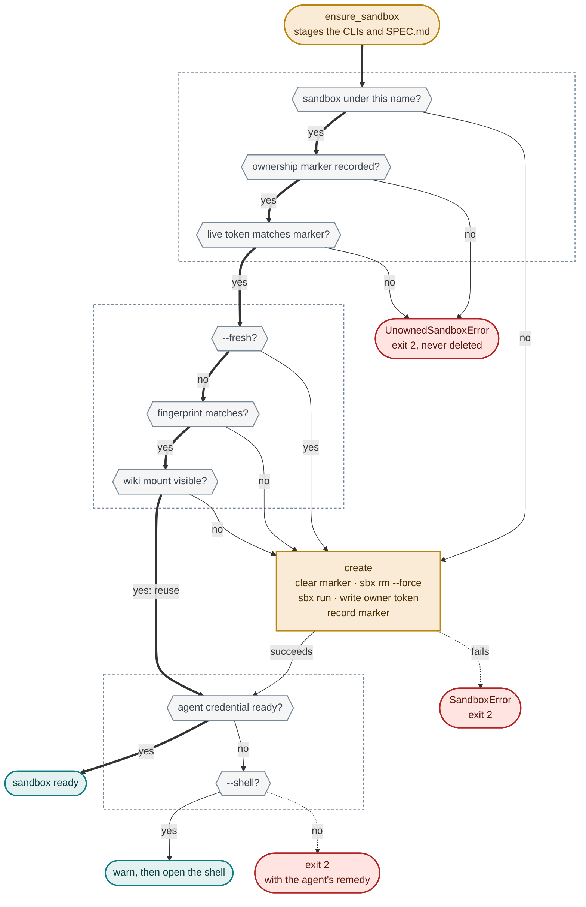

# Sandbox

How md2okf talks to sbx and decides whether the next run reuses, replaces or refuses an agent's sandbox, in [[src/md2okf/sandbox.py]] and [[src/md2okf/workbench.py]].

## The sbx seam

Every process the driver starts to talk to a sandbox goes through [[src/md2okf/sandbox.py#_run]], [[src/md2okf/sandbox.py#Exec]] or [[src/md2okf/sandbox.py#exec_interactive]], and nowhere else.

That single boundary is what makes the driver testable offline. [[tests/conftest.py]] fakes exactly these three calls, and every suite above them runs against the fake without an sbx runtime.

## Preflight

[[src/md2okf/sandbox.py#preflight]] checks that `sbx` is on PATH, at least the version in [[SBX_VERSION]], and logged in, before anything else shells out to it.

Every other function in the module assumes `sbx` exists, and a missing binary would surface as a bare `FileNotFoundError`. Preflight turns each of these conditions into a clean exit 2 with the fix. The floor is read from the bundled `SBX_VERSION` and must be exactly one `X.Y.Z`.

Preflight admits any newer sbx, but that only means the driver will run it. Kit compatibility is a separate boundary: the kits are written against the kit spec the floor release bundles, and each descriptor pins that spec's frontend by digest (see [[lat.md/kits#Kits]]). A newer sbx can still reject a kit, as sbx 0.51 rejected the old v2 kits that extended its built-in agents. When a sandbox fails to build on a newer sbx, run `make validate` first. Raising the floor follows "The sbx minimum" checklist in [[CONTRIBUTING.md]].

## Fingerprint

[[src/md2okf/workbench.py#fingerprint]] hashes the kit tree, the sbx version, the mount arguments and the agent's pinned workload reference. A change to any of them means the running sandbox no longer matches what would be built.

The kit is built into the sandbox, so an edit to any kit file only takes effect in a new sandbox. The tree hash therefore includes dotted paths: Pi's whole runtime config lives under `files/home/.pi`, and skipping dotfiles once left an edited skill without a rebuild. `_is_hash_noise` skips only named host clutter: `.DS_Store`, `._*` AppleDouble files and `__pycache__`.

The workload a mixin composes onto is outside the kit tree, so its digest is hashed on its own. It is pinned by index digest rather than named, because a bare agent name resolves through the user's `kit.shortcuts` and floats with upstream, and hashing a name could never notice that. A deliberate bump of [[src/md2okf/agents.py#CLAUDE_WORKLOAD]] or [[src/md2okf/agents.py#CODEX_WORKLOAD]] rebuilds that agent's sandbox, and nothing else does. Tests: [[tests/test_workbench.py#test_fingerprint_changes_when_the_pinned_workload_changes]] and [[tests/test_workbench.py#test_fingerprint_changes_when_the_trace_target_changes]].

Because the sbx version is part of the hash, upgrading sbx rebuilds every sandbox once, on its next use. That rebuild starts with `sbx rm --force`, so anything kept only inside the old sandbox is lost; transcripts are not, because they live on the host.

## Launch

[[src/md2okf/sandbox.py#run_argv]] builds the one `sbx run` command line that creates a sandbox. [[src/md2okf/sandbox.py#create]] runs it, and `--dry-run` prints it, so the two cannot drift.

Pi's kit is itself the workload, so its directory is the positional argument. The Claude Code and Codex kits are mixins, passed with `--kit` before the pinned workload reference. Local kits are passed as absolute paths, because sbx reads a bare relative name as an agent or sandbox name. The five mounts follow as additional workspaces, `PATH[:TARGET][:ro]`: the four `work/` mounts at their host paths, which the prompt, `merkleokf` and the probe rely on, and `sessions/` at the agent's trace directory (see [[workbench#Layout and mounts]]).

`--no-input` matters because `create` captures every stream and has no terminal. A question sbx would ask, such as a kit's permissions needing confirmation, fails instead with the command that answers it, and `create` passes sbx's own diagnostic on in its error. It keeps both streams, because sbx prints update notices to stderr and a notice must not hide the error itself. No environment is injected: the kits need none from the driver. Tests: [[tests/test_sandbox.py#test_create_runs_a_workload_kit_with_its_mounts]], [[tests/test_sandbox.py#test_create_composes_a_mixin_kit_onto_the_pinned_workload]], [[tests/test_sandbox.py#test_a_failed_create_carries_the_sbx_diagnostic]], [[tests/test_sandbox.py#test_a_failed_create_keeps_stdout_beside_an_update_notice]] and [[tests/test_cli.py#test_dry_run_prints_the_argv_create_runs]].

## Sandbox name

[[src/md2okf/workbench.py#sandbox_name]] names each agent's sandbox `md2okf-<agent>`. `MD2OKF_SANDBOX_NAME` replaces it, for maintainers piloting a kit change beside a working sandbox.

The override must go with a temporary `XDG_STATE_HOME`. The workbench, and with it the ownership marker, is keyed by agent rather than by name: the usual name over new state is refused as unowned, and a new name over the usual state would reuse the real workbench. [[tests/test-sandbox.sh]] asks the driver for the name and every path, so it honours both.

## Sandbox lifecycle

Every run that needs a sandbox goes through [[src/md2okf/workbench.py#ensure_sandbox]]. It ends in one of four outcomes: ready, refused as unowned, a failed create, or a credential that is not ready.

<!-- cspell:disable -->

<!-- cspell:enable -->

*The driver's own steps are amber and its decisions grey. The three dashed groups prove ownership, decide whether to reuse, and check the credential. The bold path is the common one, reusing a sandbox that matches. Outcomes are teal where the sandbox is usable and red where the run is refused with exit 2.*

Ownership is settled before anything is destroyed, so the only paths that reach `sbx rm --force` start from a sandbox md2okf can prove it created, or from no sandbox at all. The marker is recorded as soon as the create succeeds, before the credential check, so a sandbox refused for its credential is still recognised as owned next time. [[sandbox#Create or reuse]] gives each branch with its test, [[sandbox#Ownership token]] the marker, and [[sandbox#Credential check]] the last step.

## Create or reuse

[[src/md2okf/workbench.py#resolve_sandbox_state]] decides what happens to the agent's sandbox (see [[sandbox#Sandbox name]]). Ownership is proven before anything is reused or destroyed.

1. **No sandbox under the name**: create it. Test: [[tests/test_workbench.py#test_resolve_sandbox_state_creates_when_no_sandbox_exists]].
2. **Ownership not proven**: there is no recorded marker, or the live owner token is missing or differs from the recorded one. This raises `UnownedSandboxError`, whose message gives the manual `sbx rm --force` command. The sandbox is never deleted, and `--fresh` does not change that. Tests: [[tests/test_workbench.py#test_resolve_sandbox_state_rejects_an_unowned_sandbox]], [[tests/test_workbench.py#test_resolve_sandbox_state_rejects_a_matching_fingerprint_with_wrong_identity]] and [[tests/test_workbench.py#test_resolve_sandbox_state_fresh_does_not_widen_deletion_authority]].
3. **Ownership proven, and `--fresh`, a changed fingerprint or a failed probe**: replace it. [[src/md2okf/sandbox.py#create]] starts with `sbx rm --force`, so the old sandbox is destroyed, together with anything inside it outside the mounts. Tests: [[tests/test_workbench.py#test_resolve_sandbox_state_fresh_recreates_an_owned_sandbox]], [[tests/test_workbench.py#test_resolve_sandbox_state_recreates_on_fingerprint_change]] and [[tests/test_workbench.py#test_resolve_sandbox_state_recreates_when_probe_fails]].
4. **Ownership proven and everything matches**: reuse it. Test: [[tests/test_workbench.py#test_resolve_sandbox_state_reuses_when_everything_matches]].

The probe is a cheap in-VM check that the wiki mount is visible. It catches a sandbox whose mounts no longer resolve.

## Ownership token

[[src/md2okf/sandbox.py#create]] writes a random token to [[src/md2okf/sandbox.py#OWNER_TOKEN_PATH]] inside the new sandbox. The workbench records that token, with the fingerprint, as its ownership marker.

The token guards against accidental reuse only, such as a stale sandbox from an earlier run or an unrelated one that happens to have the name. It is not proof against an attacker, since the guest can write it. It fails safe: a missing or altered token can only cause a false rejection and exit 2, never a false acceptance.

The marker is cleared before any recreate, because the old sandbox is about to be destroyed. It is written as soon as `create` succeeds, even if the credential check that follows fails, so a sandbox md2okf really created is always recognised next time. If the token cannot be written, `create` removes the sandbox it just made rather than leave an unowned one behind.

Tests: [[tests/test_workbench.py#test_ensure_sandbox_writes_marker_even_when_the_credential_check_fails]] and [[tests/test_workbench.py#test_ensure_sandbox_clears_markers_when_a_recreation_fails]].

## Credential check

[[src/md2okf/workbench.py#ensure_sandbox]] runs the agent's credential check after every create and every reuse, so a sandbox that failed it is never silently reused while still broken.

The check itself belongs to the agent (see [[agents#Credential checks]]). When it fails, a compile, `--agent` and `python -m md2okf.sandbox` refuse with exit 2 and print the agent's remedy. `--shell` prints the remedy as a warning and opens anyway, since the sandbox itself is ready by then. [[docs/configuration.md]] explains how to set up each agent's credential.

Test: [[tests/test_workbench.py#test_credentials_are_checked_on_reuse_too]].

## Streaming exec

Each agent turn runs as one streamed `sbx exec` whose stdout and stderr arrive merged, line by line, with stdin closed.

[[src/md2okf/sandbox.py#Exec#close]] stops only the local `sbx exec` conduit. The agent runs inside the VM, and killing the conduit does not stop it there. Reaping processes inside the VM is out of scope, so an interrupted turn may keep running in the sandbox until it ends.
