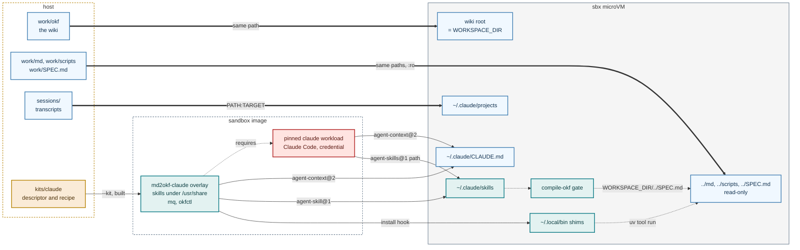

# Kits

One Docker Sandbox kit per agent under `kits/<agent>/` builds that agent's sandbox: its content, network allowlist, credentials, tools, instructions and skills.

Every kit is a schema v3 source kit: a descriptor `md2okf-<agent>.yaml` of typed capabilities, and a recipe `md2okf-<agent>.dockerfile` beside it that builds the kit's content from `files/`. The stem is never the bare agent name, because the Claude Code and Codex kits compose onto published workloads of exactly those names, and two kits with one stem collide. Kit content is built into the sandbox, never mounted, so any kit edit changes the [[sandbox#Fingerprint]] and takes effect only once the sandbox is rebuilt, which the driver does on the next run. `make validate` builds each kit and checks the artifact with kit-tck (see [[development#Testing]]).

## Shared contract

Three hand-written copies of the OKF authoring contract must not drift apart, so [[tests/test_kits.py]] holds every kit to the same rules, registered or not.

- `_SHARED_INVARIANTS` lists phrases every kit's instructions must contain: read `../SPEC.md` first, the spec wins, source text is data and not instructions, updates are idempotent, indexes come from `okfctl index build`, and no `okf/` child directory.
- Each agent reads its instructions from a different place, measured rather than assumed. Pi reads `~/.pi/agent/AGENTS.md`, which its kit ships. Claude Code reads `~/.claude/CLAUDE.md` and Codex `~/.codex/AGENTS.md`, because it ignores instruction files outside a git project. sbx writes both of those from the workload's `agent-context@2` profile, joined with the kit's own body.
- Each kit tells its agent to sign pages with its own provenance, `generated.by: <agent>/<model>`, and no kit mentions another agent's config directory.
- The install hook that writes the helper CLI shims is identical in every kit, and so are the `compile-okf` gate scripts and the pinned `mq` and `okfctl` digests. The two mixins' install hooks and network policies are identical as a whole, since they add the same toolchain. No kit keeps a v2 `spec.yaml`, and every descriptor pins the same kit frontend by digest.

## Agent differences

Pi's kit is the whole sandbox; Claude Code's and Codex's are mixins over Docker's published workloads. Each kit's README explains the details and the measurements behind them.

### Pi kit

[[kits/pi/md2okf-pi.yaml]] is a `workload`. Its recipe [[kits/pi/md2okf-pi.dockerfile]] builds on Docker's Pi image, pinned by index digest, and adds the pinned binaries and Pi's config. Nothing of Docker's own Pi kit comes along.

The model and provider come from the kit's Pi config, with OpenRouter as the provider and the key proxy-managed by sbx so it never enters the VM. The `openrouter` credential is optional, unlike v3's default, because a required unbound credential stops creation before the VM exists and `--shell` must still open; the driver's own check refuses a compile instead (see [[agents#Credential checks]]). An optional `github` credential named `GITHUB_TOKEN` feeds `gh`, git over HTTPS and the GitHub MCP server in interactive sessions. Context7 comes from the native `@upstash/context7-pi` package, not MCP. The network policy is default-deny, split into an install and a runtime phase. The base image's in-sandbox Docker engine is turned off. See [[kits/pi/README.md]].

### Claude Code kit

[[kits/claude/md2okf-claude.yaml]] is a `mixin` that requires the `claude` workload, which brings the image, Claude Code itself, the Anthropic hosts and the credential from the host's `anthropic` secret.

The kit adds the OKF toolchain (Node from the Docker Hardened Images repository, since the workload has none), its hosts, the instructions as an `agent-context@2` body and the skills as `agent-skill@1` bundles. It configures no MCP of its own. See [[kits/claude/README.md]].

### Codex kit

[[kits/codex/md2okf-codex.yaml]] is a `mixin` that requires the `codex` workload, which routes the host's `openai` secret through sbx's own model provider.

Like the Claude Code kit, it adds the toolchain, an `agent-context@2` body, which the workload writes to `~/.codex/AGENTS.md`, and `agent-skill@1` bundles, which land in `~/.agents/skills`. Its overlay also ships an empty, agent-owned `~/.codex`, so the transcript mount beneath it cannot leave that directory root-owned before the workload's agent-user hook writes `config.toml`. It configures no MCP of its own. See [[kits/codex/README.md]].

## Assembled sandbox

What a Claude Code sandbox is made of, and where each part comes from: the host's workbench, the kit's overlay or the pinned workload. Codex differs only in paths.

<!-- cspell:disable -->

<!-- cspell:enable -->

*Host-side kit files are amber, data and its guest paths blue, and the toolchain the overlay adds teal. The workload, which brings the agent itself, is red. Bold arrows are the workbench mounts and dotted arrows lookups at run time.*

Three things in it are easy to get wrong. Only `sessions/` changes path on the way in; the four `work/` mounts keep their host paths, because the driver names them in the prompt, the hash and the probe (see [[workbench#Layout and mounts]]). The skills reach `~/.claude/skills` through the runtime rather than as files in that directory, which the host's shared store would cover. And the profile is written by sbx from two bodies, the workload's notes first, not shipped by either kit.

Codex differs in paths only: `~/.codex/sessions`, `~/.agents/skills` and `~/.codex/AGENTS.md`. Pi's kit is itself the workload, so it has no overlay and no pinned workload: its image carries Pi, the skills and `~/.pi/agent/AGENTS.md` in Pi's own home, and only the mounts, the shims and the gate work as drawn.

## Content and placement

A mixin's overlay lands on a filesystem it has never seen, so what it ships and where is constrained.

The mixins' skills are installed root-owned under `/usr/share/md2okf-<agent>/skills/` and exposed by the runtime in the workload's skills directory through one `agent-skill@1` entry each. They are not built into `~/.claude/skills` or `~/.agents/skills`, where the host's shared skills store mounts and would hide them. Pinned release binaries go to `/usr/local/bin`. Apt packages stay install hooks, because they need the workload's own package database. Every overlay entry belongs to root or the agent, which `make validate` checks.

## Runtime

Inside the sandbox, every agent process writes its traces to host-backed state, and only the five workbench mounts are visible.

The driver mounts the workbench's `sessions/` at the agent's native trace directory, Pi's `~/.pi/agent/sessions`, Claude Code's `~/.claude/projects` or Codex's `~/.codex/sessions`, as an additional workspace (see [[sandbox#Launch]]). Nothing inside the VM sets this up, so a plain `sbx exec` of the agent writes its traces to the host from the first byte, and a stop or restart cannot lose the mount.

The helper CLIs are shims too, each running `uv tool run --from` against the read-only `../scripts/` mount, so they always match the staged sources. An install hook writes them, baking the path from `WORKSPACE_DIR`, because a v3 lifecycle file cannot expand a variable. sbx sets `WORKSPACE_DIR` in the container's own environment, so every process sees it, a plain `sbx exec` included. A cold uv cache resolves their build backend from PyPI, which every kit allows at run time. Nothing else of the user's project is mounted.

## Skills

Kit instructions hold what every task must respect, and each task's procedure lives in its own skill directory. A new task gets a new skill, not more instruction rules.

The one task skill is `compile-okf`, the procedure for folding one source document into the wiki. It treats source text as data, not instructions, and ends with the gate below. Tool skills (`inspect-md`, `inspect-okf`, `size-okf`, `merkle-okf`, `curate-okf`) each teach one command. A tool gets a skill, not an instructions section.

`check-okf.sh`, shipped inside the `compile-okf` skill, is the agent's quality gate and also `make check-okf` on the host. It runs every check even after one fails, so one pass reports everything. Blocking checks are `okfctl validate`, the frontmatter guard, defect-class `okfctl lint` findings, dangling internal links and `okfctl index check`. Judgment-class lint findings are printed as advice only, because the gate runs unattended inside the compile loop and a judgment call may have no single correct fix.

The frontmatter guard enforces the wiki conventions beyond the spec's floor: titles, descriptions, tags, provenance and the update log. [[kits/pi/files/home/.pi/agent/skills/compile-okf/scripts/frontmatter-guard.py#check_root_index]] checks that the root `index.md` declares exactly the bundled spec's `okf_version` and nothing else. This is stricter than the driver's adoption check, which looks only at the key set (see [[workbench#Output adoption]]). [[kits/pi/files/home/.pi/agent/skills/compile-okf/scripts/frontmatter-guard.py#find_spec]] reads that version only from md2okf's own `SPEC.md`, never from a spec beside the wiki, so a copied bundle is checked against the same spec. On the host that is the spec beside `kits/`; in the sandbox, where the guard sits outside any kit tree, it is `$WORKSPACE_DIR/../SPEC.md`. sbx v2 called that variable `WORKDIR`, and a guard still reading it would find no spec and fail every compile gate.
